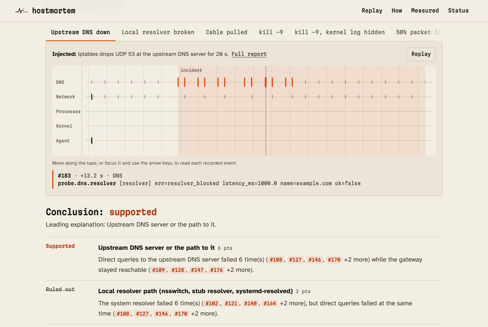

<picture>
  <source media="(prefers-color-scheme: dark)" srcset="docs/hero-dark.png">
  
</picture>

# Hostmortem

**A flight recorder for Linux edge boxes.** When a gateway loses DNS, its link
or a service and someone reboots it, the evidence usually goes with it.
Hostmortem writes kernel, network and service evidence to disk, keeps it
through the reboot, and answers with what it **knows**, what it **suspects**
and what it **could not see**.

**[Replay real incidents →](https://yousofselim.com/hostmortem-showcase/)**

This repository is the public showcase. The source is private while v0.1 settles.

## What makes it different

- **Says “unknown” when that’s the truth.** Twelve deterministic playbooks score
  evidence for and against. If nothing is supported, or two explanations tie,
  the answer is unknown, along with what it could not see. No AI decides anything.
- **Every claim cites an event.** Each hypothesis links to stored event ids (`#112`);
  a release gate rejects any that does not.
- **Time it can trust.** Boot order first, then CLOCK_BOOTTIME. Wall time is
  display-only, because RTC-less boxes wake up in 1970.
- **Loss is evidence.** A bounded two-lane queue never blocks a collector. Every
  dropped event is counted and written down as an event of its own.

## Real faults, real output

Eight faults injected into Linux network namespaces (iptables, `ip link`, tc
netem, `kill -9`, dropped capabilities, SIGKILL of the agent itself): **8 of 8
diagnosed as expected**, including two honest “unknown”s.
Details and the bugs the lab caught: [docs/lab.md](docs/lab.md).
Unedited `hm explain --html` reports: [site/reports](site/reports/).

| | |
|---|---|
| Throughput | 20,000 and 50,000 events/s offered, **0 dropped** in 15 runs |
| Agent memory | **6.0 MB** RSS idle (target < 30 MB) |
| Agent CPU | **0.08 %** of one core idle |
| SIGKILL mid-incident | 1.97 s of evidence lost (bound 5 s), store intact, same incident |
| Tests | 79, clean under ASan + UBSan and TSan |

Environment and method: [docs/performance.md](docs/performance.md) ·
[docs/testing.md](docs/testing.md). Measured on an arm64 VM, not yet on a Raspberry Pi.

## How it is built

C++20 agent (`hmd`) and CLI (`hm`). Five collectors (procfs, rtnetlink,
`/dev/kmsg`, active DNS/ICMP/TCP probes, process watch) feed a bounded queue.
One writer commits to SQLite in WAL mode, a detector opens incidents, and
`hm explain` writes text, JSON or a self-contained HTML report. It runs as a
dedicated user with two capabilities. eBPF tracepoints come in v0.2.

## Status

| Working | Not yet |
|---|---|
| Engine, CLI, 12 playbooks, reports | Real reboot / power-cut test |
| 8-scenario real-fault lab | eBPF probes (v0.2) |
| Sanitizer and fuzz targets | Raspberry Pi and x86 numbers |
| Hardened systemd unit | Packages and a tagged release; web UI (v1.0) |

## This site

One HTML page, no framework, about 30 KB of code plus 48 KB of custom fonts.
The page data is generated from the lab's own output by
[`tools/build_data.py`](tools/build_data.py) and checked in headless Chrome
(screenshots, axe WCAG 2.2 scan, phone overflow, reduced motion) by
[`tools/verify.mjs`](tools/verify.mjs). The fonts are **Hostmortem Tape** and
**Hostmortem Text**, customised from Martian Mono and Atkinson Hyperlegible
(instanced, subset, metrics tuned, renamed) under the SIL Open Font License.

Built by [Yousof Selim](https://yousofselim.com).
