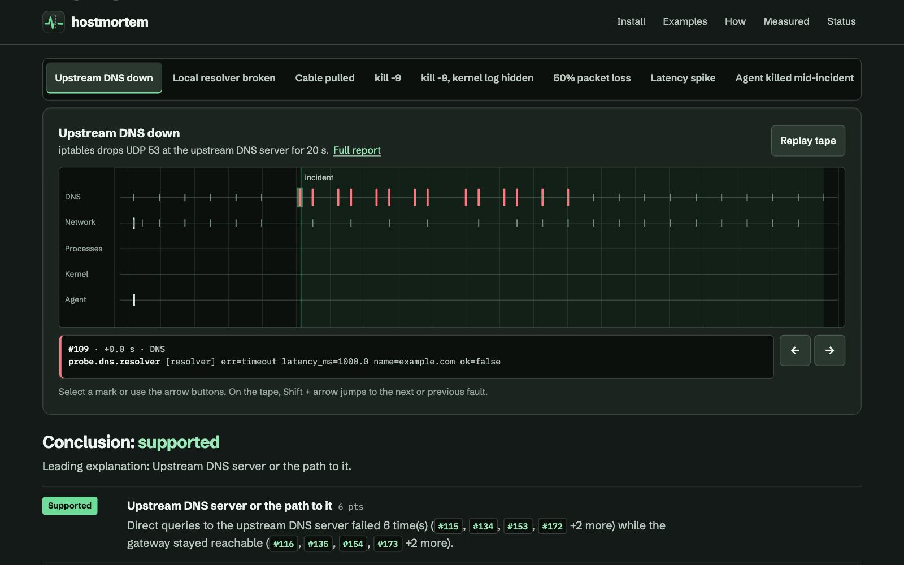

# Hostmortem

**A flight recorder for Linux edge boxes.** When a gateway loses DNS, its link
or a service and someone reboots it, the evidence usually goes with it.
Hostmortem writes kernel, network and service evidence to disk, keeps it
through the reboot, and answers with what it **knows**, what it **suspects**
and what it **could not see**.

## Install

On Ubuntu 22.04/24.04, Debian 12/13 or Raspberry Pi OS (64-bit), amd64 or arm64:

```bash
curl -fsSL https://github.com/yeegz/hostmortem/releases/latest/download/install.sh | sudo sh
sudo hm drill        # a harmless test incident, recorded by the live agent
sudo hm explain 1    # what it knows, suspects and could not see
sudo hm report       # every incident as one self-contained HTML file
```

Step by step: [QUICKSTART](https://github.com/yeegz/hostmortem/blob/main/docs/QUICKSTART.md).
Source (Apache-2.0) and releases: **https://github.com/yeegz/hostmortem**.

**[Project site: install, then real lab incidents as examples →](https://yousofselim.com/hostmortem-showcase/)**

This repository holds the project site and its data and verification scripts.

## What makes it different

- **Says “unknown” when that’s the truth.** Twelve deterministic playbooks score
  evidence for and against. If nothing is supported, or two explanations tie,
  the answer is unknown, along with what it could not see.
- **Every claim cites an event.** Each hypothesis links to stored event ids (`#112`);
  a release gate rejects any that does not.
- **Time it can trust.** Boot order first, then CLOCK_BOOTTIME. Wall time is
  display-only, because RTC-less boxes wake up in 1970.
- **Loss is evidence.** A bounded two-lane queue never blocks a collector. Every
  dropped event is counted and written down as an event of its own.

## Real faults, real output

Eleven faults injected into Linux network namespaces (iptables, `ip link`, tc
netem, `kill -9`, dropped capabilities, SIGKILL of the agent itself, a real
cgroup OOM kill, CPU saturation, a crash-restart loop): **11 of 11 met their diagnosis checks**. Some recordings are inconclusive overall.
Details and the bugs the lab caught: [docs/lab.md](docs/lab.md).
`hm explain --html` reports rendered from the original lab stores: [site/reports](site/reports/).

| | |
|---|---|
| Hard reset mid-incident (VM) | **≤ 1.4 s** of evidence lost in 2 runs; the incident survived the reboot (after fixing a durability bug this test found) |
| Throughput | **20,000 events/s, 0 dropped** in 10 runs with every commit fsynced; at 50,000/s this VM drops some (each drop recorded) |
| Install | v0.2.2 `.deb` for amd64 and arm64 plus `install.sh` ([release](https://github.com/yeegz/hostmortem/releases/tag/v0.2.2)); install → service → `hm drill` → `hm report` → purge passes on fresh Ubuntu 22.04/24.04 VMs (amd64, arm64) in CI and fresh Debian 12 / Ubuntu 24.04 VMs; `systemd-analyze security` exposure **2.6–2.8 (OK)** |
| Agent memory | **5.9–7.1 MB** RSS, 0.13–0.25 % of one core: the installed service on 4 fresh VMs, 60 s (target < 30 MB) |
| SIGKILL mid-incident | 1.94 s of evidence lost (bound 5 s), store intact, same incident |
| Tests | 92, clean under ASan + UBSan and TSan (CI on amd64 and arm64) |

Environment and method: [docs/performance.md](docs/performance.md) ·
[docs/testing.md](docs/testing.md). Measured on an arm64 VM, not yet on a Raspberry Pi.

## How it is built

C++20 agent (`hmd`) and CLI (`hm`). Five collectors (procfs, rtnetlink,
`/dev/kmsg`, active DNS/ICMP/TCP probes, process watch) feed a bounded queue.
One writer commits to SQLite in WAL mode, a detector opens incidents, and
`hm explain` writes text, JSON or a self-contained HTML report. It runs as a
dedicated user with two capabilities. eBPF tracepoints are planned for v0.3.

## Status

| Working | Not yet |
|---|---|
| Engine, CLI, 12 playbooks, reports | Physical power-cut test on real hardware |
| VM hard-reset test | eBPF probes (v0.3) |
| 11-scenario real-fault lab | |
| Sanitizer and fuzz targets | Raspberry Pi and x86 hardware numbers |
| Open source, packages, hardened systemd unit | Web UI (v1.0) and the optional ESP32 peer |

## This site

One HTML page, no framework, about 30 KB of code plus about 100 KB of self-hosted fonts.
The page data is generated from the lab's own output by
[`tools/build_data.py`](tools/build_data.py) and checked in headless Chrome
(screenshots, axe WCAG 2.2 scan, phone overflow, reduced motion) by
[`tools/verify.mjs`](tools/verify.mjs). Type: Schibsted Grotesk (everything you read)
and IBM Plex Mono (raw event data only),
all from Google Fonts under the SIL Open Font License, subset and self-hosted.

Built by [Yousof Selim](https://yousofselim.com).
